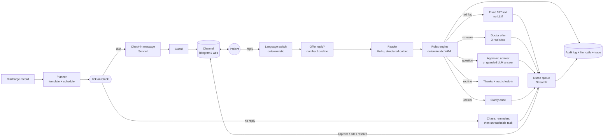

# Ala Salama (على السلامة)

**Built for the HUMAIN Hackathon, solving Challenge 3: Automation for Enterprise.**

> متابعتك ما تنتهي عند باب المستشفى — *your care doesn't end at the hospital door.*

**Demo with synthetic data. Not a medical device. All clinical content is demo content and needs clinician review before any real use.**

The name comes from "الحمد لله على السلامة", what Saudi families say when someone comes home from hospital.

---

## 1. Summary

Ala Salama is an **agentic post-discharge follow-up system**. It owns each discharged patient's 30-day follow-up end to end: it plans the schedule, messages the patient in Saudi Arabic or English, reads the reply, decides what it means with deterministic clinical rules, acts, chases people who don't answer, and brings a nurse only the exceptions. It can also offer and book a doctor appointment when a patient reports a concern.

It runs on a real messaging channel (**Telegram, verified live on a phone**), with a web chat page for demos and a Streamlit dashboard for nurses.

**Design principle:** the LLM *reads and writes*, but never *decides*. Routing, escalation, emergencies and timing are deterministic, unit-tested code. Everything the LLM writes passes a guard before a patient sees it, and every step is audited.

## 2. The business problem

After discharge, nurses or call-centre staff phone patients, work down a list, write notes, chase people who don't answer, and decide who needs a doctor. It is slow and inconsistent, and many patients are never reached. Ala Salama automates the routine 90% and puts the exceptions, with a brief and a suggested reply, in front of a nurse.

## 3. What the agent does

1. **Plan.** The procedure code maps deterministically to a template (c-section, knee replacement, heart failure). Check-ins are scheduled on days 1, 3, 7, 14 and 30 at the patient's preferred hour, moved out of approximate prayer windows and kept between 08:00 and 21:00.
2. **Check in.** At each due time it messages the patient (Claude Sonnet writes the message; if the guard blocks it, the approved template questions are sent instead).
3. **Understand.** Claude Haiku reads the reply into a fixed structured form (pain score, symptoms, medicines taken, questions, wants-a-human, confidence, evidence quotes).
4. **Decide.** A deterministic rules engine (`config/rules.yaml`) picks the route.
5. **Act** according to the route:

| Route | What happens |
|---|---|
| **red flag** | Fixed 997 emergency message (never LLM-written, no guard needed) and an urgent nurse task (SLA 15 min) |
| **concern** | Same-day nurse task (SLA 4 h) with a Claude-written brief and a suggested message. The patient gets a reassuring model-written message plus **three real doctor appointment options** |
| **unclear** | One clarifying question; if still unclear, a nurse task |
| **question** | Verbatim approved answer if one matches; otherwise a model-written answer (guarded), plus a routine nurse task |
| **routine** | Thanks, and confirms the date of the next check-in |

6. **Chase.** No reply: reminder after 6 h, a second reminder at a different time of day, then an "unreachable" nurse task after 3 attempts.
7. **Close.** At day 30 the episode closes with a short summary.

Every message, extraction, rule decision, model call and nurse action is written to an audit log with its reasons.



## 4. Features

### Core (milestones M0 to M6)
- **Planner and scheduler** driven by YAML templates, with an injectable simulated clock so a 30-day course runs in minutes.
- **Reader** (Haiku, structured output) that maps free text in Arabic or English, including dialect, Arabic-Indic digits and medicine descriptions ("the blood thinner injection"), onto a fixed form.
- **Rules engine** (`config/rules.yaml`): precedence red flag > concern > unclear > question > routine. Thresholds, SLAs and chase timing are config, not code.
- **Guard** on all LLM-written outbound text: deterministic regexes (dosage patterns, medicine-change wording, length) plus a Haiku classifier that **fails closed**.
- **Chase logic**, nurse tasks with SLA timers, one-click nurse actions (approve suggested, edit and send, resolve, close episode).
- **Prompt-injection handling**: patient text is wrapped as untrusted data; injection attempts are flagged and routed to a nurse.
- **Evaluation harness**: a labelled reply set, a keyword-bot baseline, a 100-patient LLM-role-played simulation and a manual-process model (see section 10).
- **Audit log** of every action, plus an `llm_calls` table with tokens, latency and cost.

### Channels (M7 and after)
| Channel | Status |
|---|---|
| `webchat` (default) | Works; the dashboard's Patient chat page. Nothing leaves the machine. |
| `telegram` | **Works live.** Long-polling listener (`scripts/telegram_poll.py`), persisted offset so no message is processed twice, only mapped patients are ever messaged. |

Safety on every external channel: a patient is only messaged externally if explicitly mapped (`ALASALAMA_TELEGRAM_MAP`). The 30 seed patients carry fake numbers and stay in web chat.

### Doctor appointments (new)
When the rules decide **concern**, the patient is not just told "a nurse will contact you". They get:
- a short, reassuring, **model-written opening** (`prompts/doctor_offer.md`, guarded; a fixed fallback is used if the model returns nothing or the guard blocks it), and
- **three real appointment options** built from a dummy doctor database (`config/doctors.yaml`: 7 fictional doctors across obgyn, orthopedics, cardiology and general, with working days and times). The specialty follows the patient's procedure template.

Options are built from the database, never invented by the model: at least 3 hours ahead, on working days, within 14 days, excluding slots already booked, preferring different doctors.

The patient can reply:
- **a number or ordinal** ("2", "the second", "٢") to book that slot;
- **a time or doctor** ("something around 6pm", "evening", "Dr Layla", "٦ مساء") to be re-offered the closest real slots, with an honest "that exact time isn't available, here are the closest options" when nothing fits;
- **"no"** to decline.

Booking, declining, slot-already-taken and re-offers are all deterministic code paths. The nurse task is still created. A dashboard page (Doctors) shows the roster and offered/booked slots.

### LLM-written answers to unmatched questions (new)
If a patient asks something with no approved answer (for example "are there any suggested medicines I should take?"), a Sonnet-written reply (`prompts/answer_question.md`, capped at 500 characters) goes through the guard. The prompt makes the model decline medicine advice ("I can't give medicine advice here") and avoid stop/skip/change/increase/reduce wording. If the guard blocks the reply or it is empty, the fixed "a nurse will get back to you" note is sent. A nurse task is created either way.

### Language switching (new)
- A short explicit request ("can we do this in Arabic?", `ممكن بالعربي؟`, "english please") switches the patient's language, confirms in that language and **re-asks the open check-in's questions** in it.
- An Arabic-script message from an English-language patient switches them to Arabic.
- Fully deterministic: no model call for the switch.

### Conversation polish (new)
- **Pleasantries**: a bare "thank you" or greeting after a closed check-in, an answer, an offer or a booking gets a fixed acknowledgment with the next check-in date, instead of being treated as an unclear reply.
- **Single-patient focus mode** (`ALASALAMA_ONLY_PATIENTS=Sara`): `tick` and the listener ignore every other patient, for fast, safe live tests.

### Observability (new)
- **LLM trace** (`ALASALAMA_TRACE=1`): every model call (purpose, model, system prompt, input, output) is appended to `data/logs/llm_trace.jsonl` (gitignored) so you can see exactly what the model saw and produced.
- **Dashboard** pages: Nurse queue, Doctors, Case (timeline, extracted form with evidence, rule decision, brief), Patient chat.

## 5. Dashboard tour

The nurse dashboard is a Streamlit app (`make dashboard`, http://localhost:8501). It has five pages: Home, Nurse queue, Doctors, Case and Patient chat. It refreshes itself every few seconds, so new messages, bookings and urgent alerts appear without pressing anything. Every page carries the "Demo with synthetic data, not a medical device" banner.

**Home: the overview**
- A hero banner with a live clock and date, the Arabic tagline, and one status line. With nothing urgent it reads "No urgent cases right now. The agent is following every discharged patient and will alert you here the moment one needs a nurse." When a red flag is open the banner turns red and pulses, and lists up to three patients as clickable links with a short reason and the time a nurse must respond by.
- Five headline numbers: patients followed (30), check-ins done, patients who need a nurse, urgent cases and appointments booked.
- An Activity section with four charts. *Check-ins by day* shows where each scheduled check-in stands (days 1, 3, 7, 14 and 30). *How replies were routed* counts the rules engine's decision for every reply (concern, question, red flag, routine, unclear). *Messages per day* splits outgoing agent messages from incoming patient messages. *Nurse tasks* shows tasks by priority, open versus resolved.

**Nurse queue: only the exceptions**
- Four counters: check-ins done, urgent, same-day and routine tasks.
- Below them, either the tasks (urgent first, with SLA countdowns and one-click actions) or, as in the screenshot, "No exceptions. The agent is handling everything." This is the page the product exists to keep empty.

**Case: one patient in full**
- A patient picker, a status badge (active, template, language) and a plain-language summary of the programme: procedure, check-in days, preferred language and hour, and critical medicines.
- A green "No open tasks. This case is resolved." banner when nothing is waiting. When tasks are open, a prominent "Mark resolved" button sits here instead.
- A timeline of every message in the conversation, with the extracted form, the rule decision and its reasons.
- On the right, the nurse task card. In the screenshot, Task #5 (same-day, resolved) holds a Claude-written nurse brief: what the patient reported, the rule that flagged it (`wound_redness`) and what the nurse should check.

**Doctors: the roster**
- *All doctors:* seven fictional doctors across obstetrics and gynecology, orthopedics and cardiology, shown as cards with initials, specialty, clinic and floor, working days and hours, and "booked" and "offered" badges. The header counts doctors and booked appointments.
- *One doctor:* a weekly availability strip with working days highlighted, the list of appointments with their status (Sara, booked, Tue 2026-11-03 16:00), and a day picker with a grid of 30-minute slots from 09:00 to 20:00. Booked slots (16:00 in the screenshot) are greyed out. These are the same slots the agent offers over chat, so a booking made in Telegram shows up here at once.

**Patient chat** (not pictured) lets you type as any patient in Arabic or English and watch the agent read, decide and answer exactly as it would on a real channel.

## 6. What it never does

- Never diagnoses, never changes medication, never gives medical advice that isn't approved or declined by a guarded prompt.
- Never lets the LLM choose the route. Rules are deterministic and unit-tested.
- Never sends LLM-written text to a patient without the guard. The fixed emergency message is the only exception because it is fixed text.
- Never invents appointment slots. Options come from the database only.
- Never guesses: if a call fails, times out or is low confidence, the case goes to a nurse.
- Never messages an unmapped patient on an external channel.
- Treats patient text as untrusted data; instruction-injection attempts are flagged and routed to a nurse.

## 7. Human checkpoints

- A nurse reviews every red flag, concern, unclear-after-clarification, unanswered question and unreachable patient.
- The nurse can approve the suggested action, edit and send, mark resolved, or close the episode, in one click.
- All clinical content (templates, thresholds, approved answers, SLAs, emergency text) is labelled **needs clinician review** and must be signed off before real use.

## 8. Live test findings (Telegram, one patient)

The system was tested live on a phone, with the user typing scenarios one at a time and the results read back from the database. Verified:

| Scenario | Result |
|---|---|
| Scheduled check-in | Delivered on Telegram |
| Routine reply ("pain 2, wound clean, took my meds") | Routine, thanks with the next check-in date, no nurse task |
| Concern (wound redness, pain 4+) | Model-written reassurance + 3 real slots + nurse task |
| "Anything around 6pm with Dr Layla?" | Re-offered her closest real slots; picking `2` booked it, with the 997 line in the confirmation |
| Medicine question | Model-written decline of medicine advice, passed the guard |
| "I have chest pain" | Fixed 997 emergency message and an urgent nurse task |
| "Thank you" after an answer | Fixed acknowledgment with the next check-in date |
| Arabic request, then Arabic routine reply | Switched language, re-asked questions in Arabic, handled the Arabic reply as routine |

Bugs found live and fixed: an empty doctor opening (token limit too low), the guard correctly blocking a model reply that said "keep taking your medicines" (prompt reworded, **guard not loosened**), duplicate Telegram timeout argument, SQLite lock contention (30 s busy timeout), an Arabic request getting an English clarify (language switch), and tests that had messaged the real chat (tests now scrub all channel env vars).

## 9. Run it

```bash
python3 -m venv .venv && . .venv/bin/activate
pip install -e ".[dev]"
cp .env.example .env          # set ANTHROPIC_API_KEY
make seed && make dashboard   # http://localhost:8501
make test                      # offline, no key needed
make eval                      # needs the key; fills results/summary.json
python -m pytest -m integration   # live reader test, needs the key
```

Without an API key the app still runs on template text, but replies cannot be read and go to a nurse.

### Telegram on your own phone
1. Create a bot with @BotFather and copy its token. Message the bot once, then find your numeric chat id.
2. In `.env`:
   ```
   ALASALAMA_CHANNEL=telegram
   TELEGRAM_BOT_TOKEN=<token>
   ALASALAMA_TELEGRAM_MAP=Sara=<your chat id>
   ALASALAMA_ONLY_PATIENTS=Sara
   ```
3. `make seed`, then `make live` (real clock; schedules Sara's check-ins from now, the first in 1 minute and the rest 5 minutes apart).
4. In one terminal run `make telegram` (the listener and scheduler), in another `make dashboard`. Sara's check-ins arrive on your Telegram and your replies go through the same reader, rules and nurse queue. The dashboard refreshes on its own.

### Configuration (environment)
| Variable | Purpose |
|---|---|
| `ANTHROPIC_API_KEY` | Claude access |
| `ALASALAMA_CHANNEL` | `webchat` (default) or `telegram` |
| `ALASALAMA_TELEGRAM_MAP` | Which demo patient maps to a real Telegram chat |
| `ALASALAMA_ONLY_PATIENTS` | Focus mode: only these patients are processed |
| `ALASALAMA_TRACE` | `1` to write the LLM trace |
| `ALASALAMA_DB`, `ALASALAMA_NO_LLM` | DB path override; run without any model calls |
| `TELEGRAM_BOT_TOKEN` | Telegram bot credential |

Run the full suite safely with `TELEGRAM_BOT_TOKEN=invalid python -m pytest -q`. `tests/conftest.py` also scrubs these, and `test_isolation.py` guards it.

## 10. Evaluation (simulated, 100 synthetic patients, seed 7)

> **Read this first.** The patients are synthetic and role-played by an LLM from hidden truth cards. The manual process is a *model*. **Every manual-process parameter in `config/baseline.yaml` is currently an unsourced placeholder**, and the nurse review minutes for Ala Salama are demo values. The comparison shows how the agent behaves in simulation. It is not a measured clinical or operational result. These numbers come from a full re-run (2026-10-31) with the current agent: written replies, the check-up decision step and the never-ending conversation.

**A. Understanding accuracy** (52 labelled replies, labels **not yet human-reviewed**):

| | Keyword bot | Claude reader |
|---|---|---|
| Red-flag recall | 67% | 100% |
| Concern recall | 91% | 100% |
| False-alarm rate | 0% | 0% |
| Pain accuracy | 94% | 100% |
| Route accuracy | 87% | 100% |

The labels were written alongside the reader prompt, so the Claude numbers are probably optimistic.

**B. Process simulation** (500 check-ins):

| | Manual (placeholder model) | Ala Salama |
|---|---|---|
| Reached within 48 h | 55% | 90% |
| Red flags caught within 48 h | 10 / 19 | 18 / 19 |
| Median red flag to nurse alert | ~25 h | ~68 min |
| Concerns caught within 48 h | 28 / 43 | 39 / 43 |
| Nurse minutes per patient | 77 | 9.3 |
| False alarms | not modelled | 0 of 393 calm check-ins |
| LLM cost per patient | $0 | ~$0.057 (3,029 calls, 46 failed and fell back to fixed text) |

The one missed red flag was a patient who never replies. Three of the four missed concerns were slow responders who answered after the check-in was closed as unreachable. Results are cached on disk, so `make eval` re-runs are free and identical.

## 11. Tests

**147 tests pass** (offline, no key needed): rules, router, tick and chase, guard, doctors and booking (`test_doctors.py`), rescheduling by time and doctor (`test_reschedule.py`), LLM answers (`test_question_answer.py`), language switching (`test_language.py`), pleasantries, focus mode, channel isolation, Telegram and demo-safety checks. One live integration test is deselected by default.

## 12. Known limits (be honest about these)

This is an **agentic, production-minded prototype, not an enterprise system.**

- **Storage:** SQLite, single process. No multi-user concurrency, backup or migration story.
- **Security:** no authentication or role-based access for nurses, no encryption at rest, no PHI/PDPL/HIPAA compliance work. Telegram is not an approved clinical channel.
- **Integration:** no EHR/HIS integration. Patients and discharge records are seeded, not pulled from a hospital system.
- **Clinical content:** all thresholds, templates, SLAs and approved answers are demo values awaiting clinician sign-off.
- **Evaluation:** the manual-baseline figures are placeholders; the labelled set was written with the reader prompt and has not been human-reviewed; patients in the simulation are LLM role-play.
- **Language:** switching is deterministic and covers Arabic and English only. A greeting sent right after an emergency message gets a clarify rather than a friendly reply (deliberate: no cheerful reply after a 997 message).
- **Not yet exercised live:** a missed-medicine message end to end, reminders and unreachable escalation over a real channel, injection attempts over Telegram, and non-text messages (stickers, voice notes).
- **Secrets:** keys used during development (Anthropic, Telegram) were exposed in the working environment and must be **rotated** before any sharing.

## 13. Layout

```
alasalama/   core package (no UI dependency)
  planner, tick, clock       scheduling and the simulated clock
  reader, rules, router      understand -> decide -> act
  guard, outbound            outbound safety gate
  chase, tasks, nurse        reminders, nurse tasks and actions
  doctors, textnorm          appointment offers/booking, shared Arabic/English text normalisation
  channels, telegram_channel
  llm, prompts/              model wrapper (cache, trace, cost log) and prompt files
config/      rules.yaml, doctors.yaml, templates/*.yaml, prayer_windows.yaml, baseline.yaml, pricing.yaml
dashboard/   Streamlit app and pages
scripts/     telegram_poll.py, live_setup.py
eval/        labelled replies, baseline bot, simulator, manual baseline
tests/       pytest (offline; integration marked)
```

See [DECISIONS.md](DECISIONS.md) for every assumption.

## 14. Change log (what was built, in order)

| Stage | What |
|---|---|
| M0 to M2 | Data model, templates, planner, simulated clock, deterministic rules, tick loop |
| M3 to M4 | Reader (structured output), router, guard, chase and unreachable logic, nurse actions |
| M5 | Streamlit dashboard: queue, case, chat, control panel, audit |
| M6 | Evaluation harness: labelled set, keyword baseline, 100-patient simulation, manual-process model |
| M7 | Telegram channel (live) with chat-id mapping |
| After M7 | Single-patient focus mode; SQLite busy timeout; listener offset persistence; test isolation from real channels |
| Conversation | Pleasantry acknowledgments; opt-in LLM trace |
| Doctors | Dummy doctor database, appointment offers, booking by number, rescheduling by time of day and doctor, Doctors page |
| Answers | Guarded LLM-written answers for unmatched questions, with fixed fallback |
| Language | Deterministic Arabic/English switching that re-asks the open questions |

*Everything after M7 is uncommitted in the working tree at the time of writing.*
